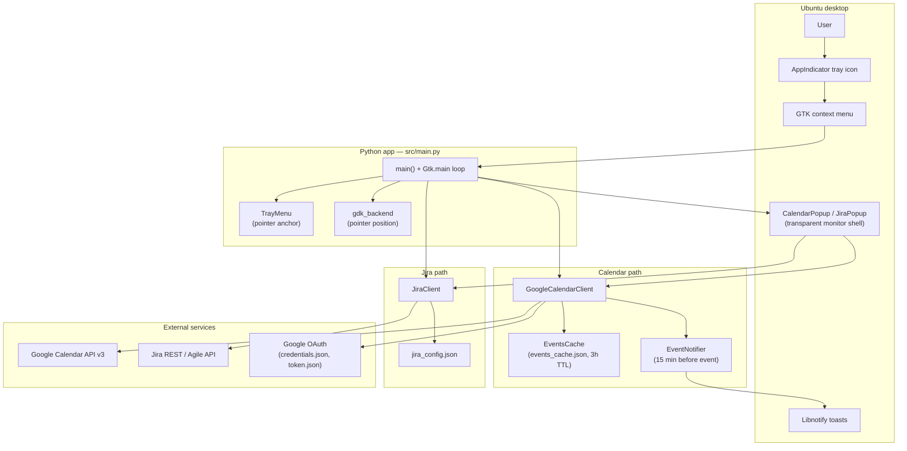
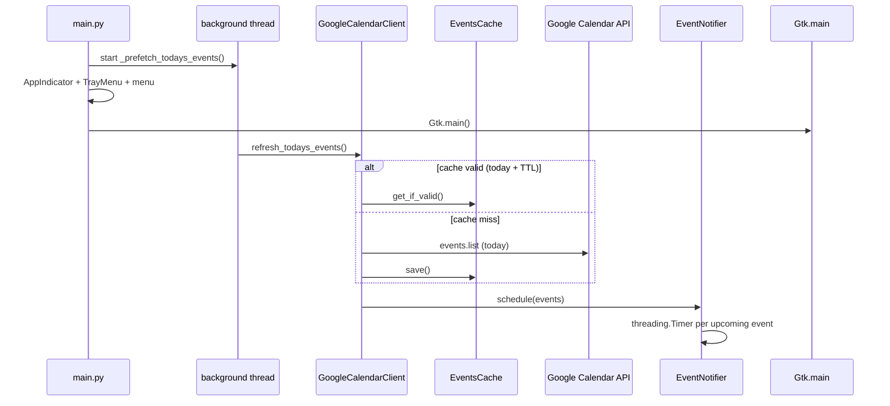
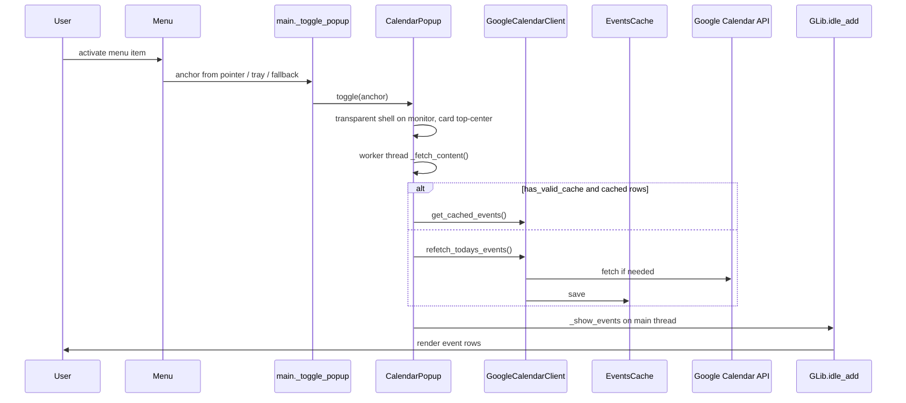
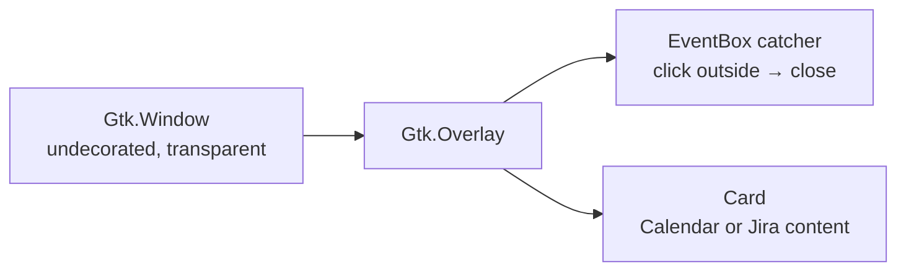

# Architecture

How **gmail-notification** fits together: tray entry point, calendar and Jira popups, caching, and desktop notifications.

> **Viewing diagrams:** Many editors (including Cursor’s Markdown preview) show Mermaid as plain text. Open **[architecture.html](architecture.html)** in a browser for rendered diagrams. On [GitHub](https://github.com), this file renders Mermaid in the web UI.

## Component overview



## Source modules

| Module | Responsibility |
|--------|----------------|
| `main.py` | AppIndicator, menu, popup toggles, startup prefetch |
| `tray_menu.py` | Attaches menu to indicator; records pointer position for monitor anchoring |
| `popup/windows.py` | `CalendarPopup`, `JiraPopup`, shared shell UI and positioning |
| `clients/google_calendar.py` | OAuth, Calendar API, today’s events |
| `events_cache.py` | In-memory + disk cache, TTL, `CalendarEvent` model |
| `notification/event_notifier.py` | Schedules libnotify reminders 15 minutes before events |
| `clients/jira_client.py` | JQL search, sprint name, ticket parsing |
| `gdk_backend.py` | GDK pointer position compatibility (Wayland / GTK versions) |
| `popup/layer_shell.py` | Optional gtk-layer-shell helpers (wlroots; not used on GNOME Mutter) |
| `notification/simulate_notification.py` | Dev helper for notification testing |

## Startup



On launch, `gdk_backend.configure()` runs before GTK imports (reserved for future GDK tweaks).

## Show today’s events



## Show Jira tickets

```mermaid
sequenceDiagram
    participant User
    participant Pop as JiraPopup
    participant Jira as JiraClient
    participant API as Jira POST /search/jql
    participant GTK as GLib.idle_add

    User->>Pop: toggle()
    Pop->>Pop: shell + status filter checkboxes
    Pop->>Jira: search() in background
    Jira->>API: JQL from jira_config.json
    API-->>Jira: issues + sprint custom field
    Jira-->>Pop: JiraSearchResult
    Pop->>GTK: _show_tickets
    GTK->>User: rows; click ticket key to copy
```

## Popup UI layering



On GNOME Wayland the shell is sized to the target monitor (`gdk_window.move_resize`) instead of moving a small popup window. The card is placed with overlay margins (horizontally centered, vertically just below the top bar work area).

## Local data files

| File | Role |
|------|------|
| `credentials.json` | Google OAuth client configuration |
| `token.json` | Stored user OAuth token (expiry normalized to naive UTC for google-auth) |
| `events_cache.json` | Today’s events and `filled_at` timestamp (3 hour TTL) |
| `jira_config.json` | Jira server URL, auth, JQL, optional `board_id` for sprint name |

## Threading model

- **GTK main thread**: All UI (`Gtk.main`, popups, notifications via `GLib.idle_add`).
- **Background threads**: Calendar prefetch on startup; popup `_fetch_content` for API calls; `EventNotifier` uses `threading.Timer` for reminder delays.

API results are always applied on the main loop with `GLib.idle_add` before updating widgets.
